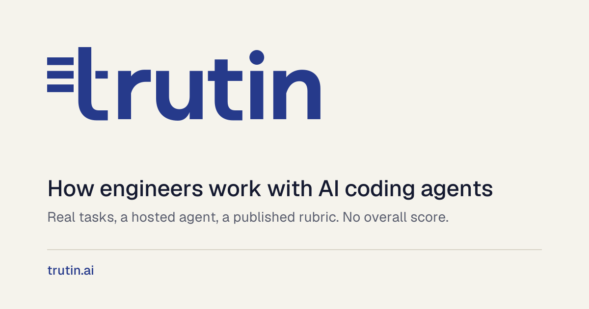

Trutin shows how engineers work with AI coding agents. A realistic task, a hosted agent and an open rubric checked against expert reviewers.

[trutin.ai](https://trutin.ai) · [Rubric](https://trutin.ai/rubric) · [Pricing](https://trutin.ai/pricing) · [Help](https://trutin.ai/help)

## Practice, Hire and Train

**Practice.** For individual developers. Rehearse an AI-assisted interview on a real codebase and get private feedback within minutes: six bands, two things to change and one strength.

**Hire.** For hiring teams on Ashby. Add a Trutin step to your interview plan. Your team sees bands with timestamped evidence and a replay, then makes the decision.

**Train.** For engineering teams, coming in year 2. Employees build the skill on training tasks with private feedback. Admins see cohort medians for groups of five or more, never individual scores.

## What we measure

Framing, delegation, verification, comprehension, maintainability and calibration. Each gets a band: weak, solid or strong. There is no overall score, and a person makes every hiring decision.

[Read the rubric](https://trutin.ai/rubric)
